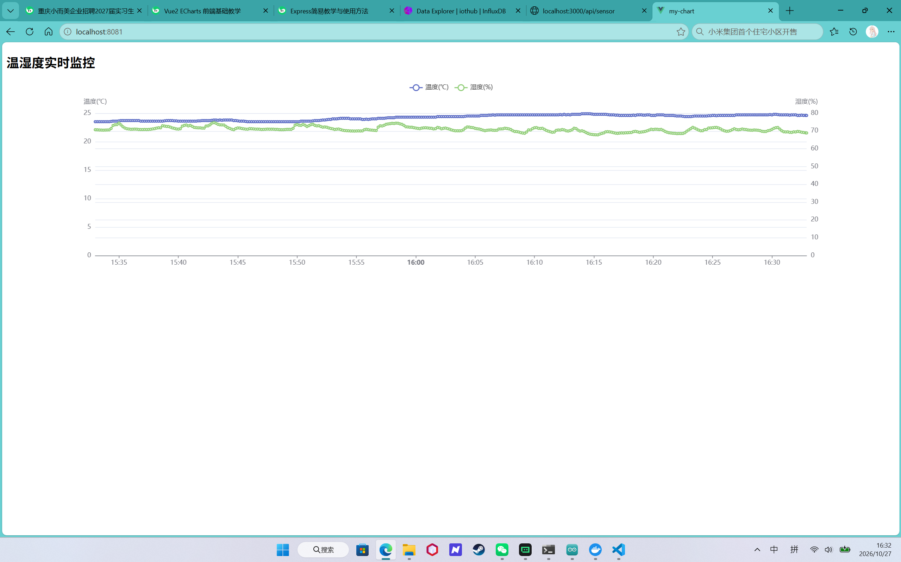
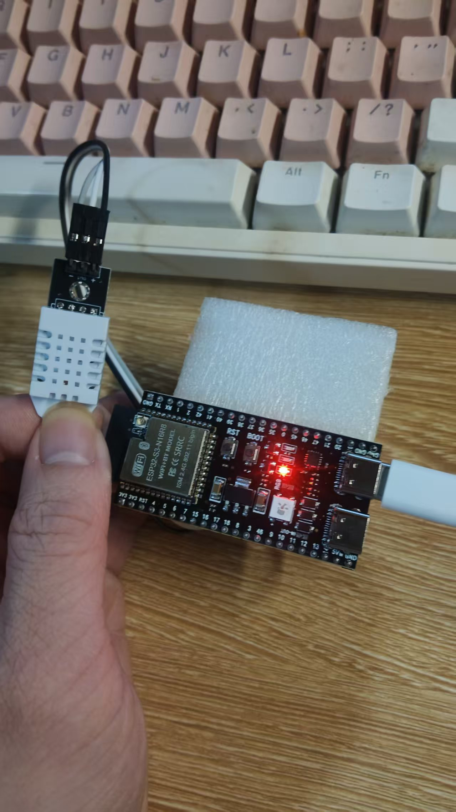
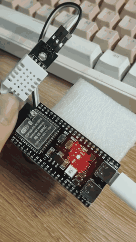
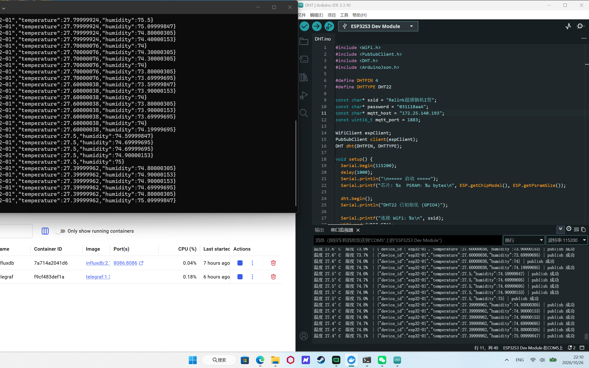
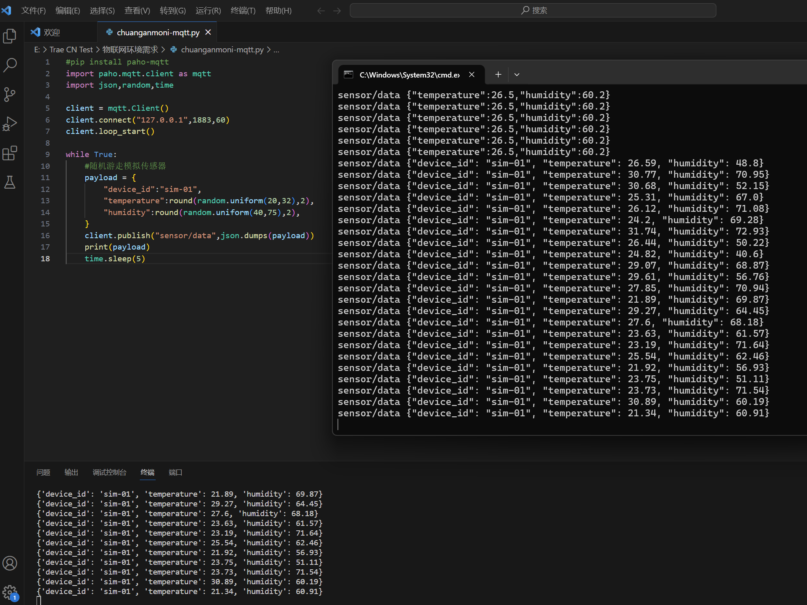

# 物联网温湿度实时监测看板

一个从硬件采集到前端可视化的完整物联网数据链路：**ESP32 + DHT22 → MQTT(Mosquitto) → Telegraf → InfluxDB 2.x → Express API → Vue2 + ECharts**。

目标是解决"传感器数据只有串口输出、无法长期留存与远程查看"的问题：设备每 5 秒上报一次温湿度，数据落进时序库后可按任意时间窗聚合查询，前端以双轴曲线实时呈现，并在超过阈值时主动告警。



---

## 一、整体架构

```mermaid
flowchart LR
    A["DHT22 温湿度传感器"] -->|单总线| B["ESP32 采集节点<br/>5s 采集 · JSON 封装"]
    B -->|MQTT / TCP 1883<br/>topic: sensor/data| C["Mosquitto Broker"]
    C -->|订阅 sensor/#| D["Telegraf<br/>MQTT Consumer"]
    D -->|Line Protocol| E["InfluxDB 2.x<br/>bucket: sensor"]
    E -->|Flux 聚合查询| F["Express API<br/>RESTful + WebSocket"]
    F -->|HTTP 轮询 5s / WS 推送| G["Vue2 + ECharts<br/>双轴曲线 + 超限告警"]
```



| 环节 | 技术 | 职责 |
|---|---|---|
| 采集端 | ESP32 + DHT22 + Arduino C++ | 5 秒采集温湿度，ArduinoJson 封装后通过 MQTT 上报 |
| 消息中枢 | Mosquitto 2.0 | 主题 `sensor/data` 的消息分发，支持多节点接入 |
| 数据桥接 | Telegraf 1.30 | `mqtt_consumer` 插件订阅 `sensor/#`，JSON 解析后转 Line Protocol |
| 时序存储 | InfluxDB 2.7 | `bucket=sensor`，按时间窗口聚合，默认 7 天保留策略 |
| 后端服务 | Node.js + Express 5 + ws | Flux 查询封装为 RESTful 接口，WebSocket 推送最新值与告警 |
| 前端看板 | Vue 2 + ECharts 5 + axios | 双 Y 轴实时曲线、5 秒刷新、阈值线、超限标红、桌面通知 |

---

## 二、功能特性

**数据链路**
- ESP32 节点按 5 秒频率采集并上报，JSON 结构固定为 `{"device_id","temperature","humidity"}`
- Telegraf 订阅 `sensor/#` 通配主题，多设备天然支持，`device_id` 作为 tag 保留
- InfluxDB 按 10 秒窗口 `aggregateWindow(fn: mean)` 降采样，把 5 秒原始点聚合成均值，显著降低前端绘制点数与查询压力

**后端 API**
- 历史数据接口固定返回最近 1 小时、10 秒聚合的双字段序列，直接喂给 ECharts
- 阈值支持运行时通过 `POST /api/threshold` 修改，并持久化到 `threshold.json`
- 服务端每 30 秒轮询最新值做超限判定，**只在状态翻转时推送**（超限推 `alarm`、回落推 `recover`），避免重复弹窗
- WebSocket 客户端刚连接时立刻收到 `hello`（含当前阈值与最新值），无需等待下一轮轮询

**前端看板**
- 双 Y 轴同时展示温度与湿度，5 秒自动刷新
- 阈值虚线参考线 + 超限点 `markPoint` 红色标记
- WebSocket 断线后 5 秒自动重连，连接状态可视化
- 浏览器桌面通知告警，需用户手动授权
- 窗口 resize 自适应，组件销毁时清理定时器 / WebSocket / 图表实例

---

## 三、目录结构

```
iot-sensor-dashboard/
├── docker-compose.yml          # Mosquitto + InfluxDB + Telegraf 一键启动
├── .env.example                # 环境变量模板（复制为 .env 后填写 Token）
├── backend/                    # Node.js + Express + WebSocket 后端
│   ├── DHT.js
│   ├── package.json
│   └── .env.example
├── frontend/                   # Vue2 + ECharts 前端看板
│   ├── src/components/SensorChart.vue
│   ├── vue.config.js           # /api 开发代理，规避跨域
│   └── package.json
├── firmware/DHT/DHT.ino        # ESP32 温湿度采集固件
├── infra/
│   ├── mosquitto/mosquitto.conf
│   └── telegraf/telegraf.conf
├── simulator/
│   └── sensor_sim.py           # 无硬件时的数据模拟器
└── docs/images/                # 实物图、看板截图、演示 GIF
```

---

## 四、快速开始

### 1. 启动基础设施（MQTT + 时序库 + 桥接）

```bash
cp .env.example .env          # Windows: copy .env.example .env
# 打开 .env，把 INFLUX_TOKEN 改成你自己的 Token
docker compose up -d
```

启动后：

| 服务 | 地址 |
|---|---|
| Mosquitto | `mqtt://localhost:1883` |
| InfluxDB | http://localhost:8086 （`admin` / `iot123456`） |
| Telegraf | 容器内运行，日志用 `docker compose logs -f telegraf` 查看 |

> InfluxDB 首次启动会自动建 Org `iothub`、Bucket `sensor`，并把 `.env` 中的 `INFLUX_TOKEN` 注册为管理员 Token。

### 2. 产生数据

**方式 A：真实硬件**

固件在 `firmware/DHT/DHT.ino`，用 Arduino IDE 打开后按下面三项修改再烧录：

| 位置 | 需要改成 |
|---|---|
| `ssid` / `password` | 你的 WiFi 账号密码（**必须是 2.4GHz**，ESP32 不支持 5GHz） |
| `mqtt_host` | 运行 Mosquitto 那台电脑的局域网 IP（如 `192.168.1.100`），不能写 `127.0.0.1` |
| `DHTPIN` | DHT22 DATA 实际接的 GPIO（默认 GPIO4） |

接线：DHT22 `VCC → 3.3V`、`DATA → GPIO4`、`GND → GND`。
Arduino IDE 需安装 `PubSubClient`、`DHT sensor library`、`ArduinoJson` 三个库。

**方式 B：无硬件时用模拟器**

```bash
pip install paho-mqtt
python simulator/sensor_sim.py
```

模拟器每 5 秒发布一条温湿度数据，JSON 结构与固件完全一致，后续链路无需任何改动。

### 3. 启动后端

```bash
cd backend
npm install
cp .env.example .env          # 填写 INFLUX_TOKEN
npm start                     # http://localhost:3000
```

### 4. 启动前端

```bash
cd frontend
npm install
npm run serve                 # http://localhost:8080
```

---

## 五、API 说明

| 方法 | 路径 | 说明 |
|---|---|---|
| GET | `/api/health` | 健康检查，返回运行时长与当前阈值 |
| GET | `/api/sensor` | 最近 1 小时温湿度，10 秒聚合均值 |
| GET | `/api/latest` | 最新一条温湿度 |
| GET | `/api/threshold` | 查看当前阈值 |
| POST | `/api/threshold` | 修改阈值 `{ "temperature": 30, "humidity": 80, "enabled": true }` |
| WS | `ws://localhost:3000` | 消息类型：`hello` / `latest` / `alarm` / `recover` / `threshold` |

核心查询（Flux）：

```flux
from(bucket: "sensor")
  |> range(start: -1h)
  |> filter(fn: (r) => r["_measurement"] == "sensor")
  |> filter(fn: (r) => r["_field"] == "temperature" or r["_field"] == "humidity")
  |> aggregateWindow(every: 10s, fn: mean, createEmpty: false)
```

---

## 六、运行效果

**硬件实物**（ESP32 + DHT22，5 秒采集一次并 WiFi 上报）



**端到端实录**（视频转 GIF，展示从传感器读数到看板刷新）



**界面与数据**

| 真实传感器数据入库 | 前端 Vue2 看板 |
|---|---|
|  |  |

| 无硬件时的 Python 模拟器 |
|---|
|  |

---

## 七、踩坑记录

这些都是实际调试中遇到的问题，记录在此便于复现与排查。

**1. Docker Desktop 在 Windows 上无法启动，WSL 报 `ERROR_NOT_FOUND`**

现象：`Wsl/Service/RegisterDistro/CreateVm/MountDisk/HCS/ERROR_NOT_FOUND`，手动 `diskpart` 挂载任意 `.vhd/.vhdx` 都报 `0xc03a0014 找不到指定文件的虚拟磁盘支持提供程序`。

根因：`FSDepends.sys`（文件系统依赖过滤驱动）默认按需加载，与 `VHDMP.sys` 存在初始化时序冲突，导致虚拟磁盘子系统整体失效。

修复：把 `HKLM\SYSTEM\CurrentControlSet\Services\FSDepends` 的 `Start` 从 `3` 改为 `0`（引导加载），重启后恢复。

**2. Mosquitto 2.0 默认拒绝外部连接**

2.0 起默认只监听 `127.0.0.1`，ESP32 必然连不上。必须在 `mosquitto.conf` 显式声明 `listener 1883 0.0.0.0` 与 `allow_anonymous true`（仅限本地实验）。

**3. DHT22 读取间隔不能小于 2 秒**

读取过快会直接返回 `NaN`，固件里必须判断 `isnan()` 并跳过本次上报，否则会把脏数据写进时序库。

**4. Docker 容器访问宿主机服务**

Windows / macOS 用 `host.docker.internal`，Linux 用 `--network host`。本仓库改用 compose 同一网络内的服务名（`mosquitto` / `influxdb`）访问，跨平台一致。

**5. 前端请求后端出现 CORS 报错**

两种解法：后端加 CORS 头（本项目 `DHT.js` 内已实现），或前端 `vue.config.js` 配置 `devServer.proxy`。二者选其一即可。

**6. InfluxDB Token 泄露风险**

Token 一旦提交到 GitHub 等于公开数据库写权限。本项目所有 Token 均通过 `.env` 注入，仓库内只保留 `.env.example` 占位符，`.gitignore` 已排除 `.env` / `token.env`。

**7. InfluxDB 返回 UTC 时间**

前端 `xAxis: { type: 'time' }` 会自动按浏览器时区渲染，不要手动加减 8 小时。

---

## 八、简历描述（可直接引用）

> **物联网设备数据实时监测看板 | 独立开发**
>
> 技术栈：ESP32 + DHT22 + MQTT(Mosquitto) + Telegraf + InfluxDB 2.x + Node.js(Express) + Vue2 + ECharts
>
> - 基于 ESP32 与 DHT22 搭建温湿度采集节点，使用 Arduino C++ 实现传感器数据采集与 JSON 封装，经 MQTT 协议按 5s 频率上报至自建 Mosquitto Broker。
> - 使用 Telegraf 订阅 MQTT 主题并将数据写入 InfluxDB 时序数据库，通过 Flux 的 `aggregateWindow` 实现 10s 粒度降采样聚合，降低高频写入下的查询与绘制压力。
> - 基于 Node.js + Express 封装数据查询 API，通过 Flux 查询语言聚合时序数据，向前端提供 RESTful 接口。
> - 前端采用 Vue2 搭建单页看板，接入 ECharts 实现温湿度双轴实时曲线（5s 自动刷新）与超阈值告警标记；服务端以 WebSocket 主动推送告警，前端触发浏览器桌面通知。

---

## 九、说明

- Mosquitto 在 Windows 上也可直接安装使用（本项目开发期即如此），仓库只保留配置文件，不收录安装包与二进制。
- `allow_anonymous true` 仅适用于本地实验，任何公网环境请改为密码认证或 TLS。
